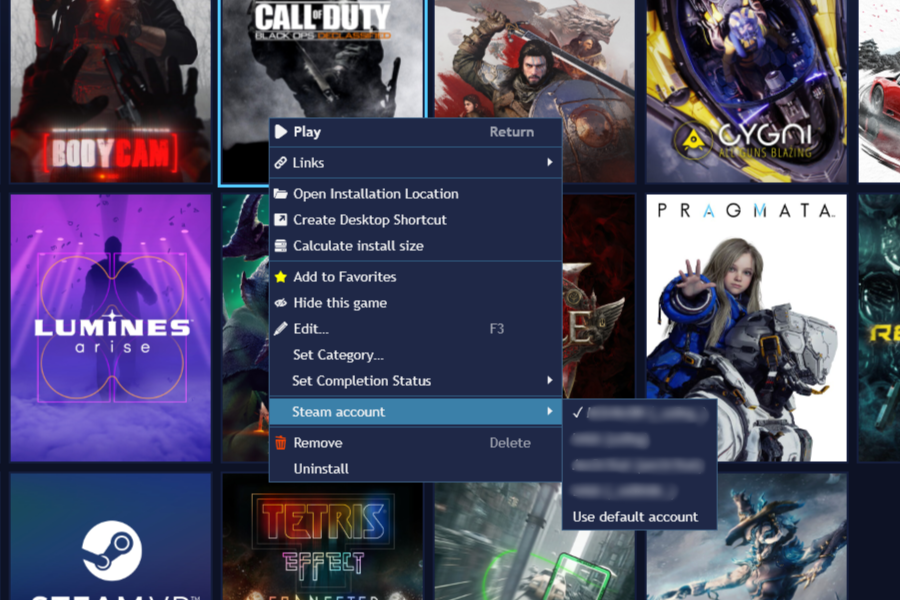
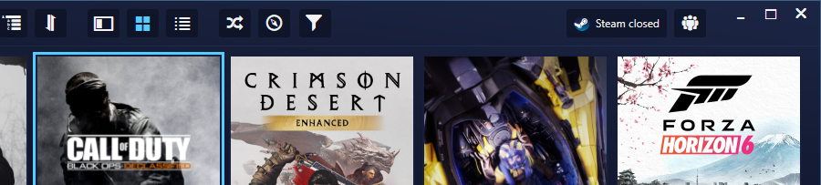
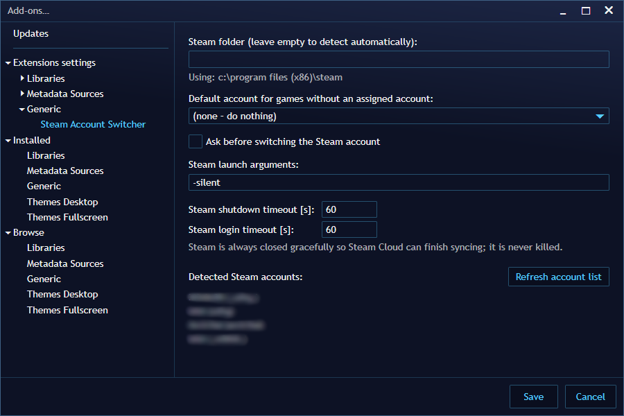

# Steam Account Switcher for Playnite

A [Playnite](https://playnite.link) 10 add-on for people with more than one Steam account. Assign a Steam account to each game; when you start the game, the add-on checks which account Steam is logged into and switches it **only when needed**. It never touches passwords.

## Features

- **Per-game account**: right-click one or many games → *Steam account* → pick an account. The account list is read automatically from Steam.
- **Switch only when necessary**: if Steam already runs on the right account, the game starts immediately. Otherwise Steam is closed gracefully, restarted on the assigned account, and the game starts once the login has finished.
- **Safe with running games**: if a Steam game is running on the current account, you are asked before Steam is closed.
- **Never kills Steam**: Steam is always closed with `steam.exe -shutdown`, so Steam Cloud can finish syncing your saves. If closing or logging in takes longer than the timeout, you can choose to keep waiting or cancel the game start.
- **Top panel**: shows the account Steam is logged into (Steam icon + profile name). Click it to switch accounts manually.
- **Ask before start**: for games you play on more than one account, pick the account each time the game starts.
- **Default account** for games without an assignment (optional).
- Works in both Desktop and Fullscreen mode.
- English and Polish UI.

## Scope

The add-on has one job: switching Steam to the right account **before a game starts**. It does not touch Playnite's Steam integration at all. It doesn't log in to Steam, doesn't use Steam Web API keys and doesn't import games. It works the same whether or not the integration is logged in.

- **Games from other accounts in your library**: this is handled by Playnite's built-in Steam integration. Without logging in, it scans your disk and adds installed games from all accounts. To also get uninstalled games from your other accounts, add them under **Additional Accounts** in the Steam integration settings.
- **Which account owns a game**: Playnite doesn't know this, so you assign the account yourself (right-click → *Steam account*, works for many games at once).

### Planned

Picking the account automatically, based on which account last played the game. Steam stores this locally in each account's `userdata\<account>\config\localconfig.vdf` (`LastPlayed`), so it would still work without logging in anywhere.

## Requirements

- Playnite 10 on Windows 10/11.
- Steam with every account you want to use logged in at least once **with "Remember me" checked**. Accounts without a remembered password are marked in the menu and in the settings; for those Steam shows its login window and you log in yourself.

## Installation

1. Download the `.pext` file from the [latest release](https://github.com/b4sh/playnite-steam-account-switcher/releases/latest).
2. Open it (double-click, or drag it onto the Playnite window) and confirm the installation.
3. Restart Playnite.

Optional, but recommended: if Playnite is set to close Steam after a game exits, turn that off – the add-on leaves Steam running on purpose.

## Usage

### Assign accounts

Select one or more games, right-click → **Steam account** → choose an account. The current assignment is marked with ✓ (when a single game is selected). **Ask before start** shows an account picker every time the game starts. **Use default account** removes the assignment.



### Start a game

| Steam state | What happens |
|---|---|
| Not running | Steam starts on the assigned account, then the game starts |
| Running on the assigned account | Nothing – the game starts immediately |
| Still logging in | Waits for the login, then decides again |
| Running on another account | Steam is closed and restarted on the assigned account (optionally after asking) |
| Running on another account **with a game running** | You are asked first; *No* cancels the game start and leaves Steam alone |

Games without an assignment (and no default account) are not touched at all.

With **Ask before start**, a window lists your accounts before the game starts, with the logged-in account preselected. It uses Playnite's own dialog, so it follows your theme and works with a controller in Fullscreen mode; with more than four accounts, *More accounts…* shows the next ones. Choose an account and the table above applies, without the extra "switch?" question. *Cancel game start* cancels the game start and leaves Steam alone.

### Top panel

The top panel item shows *Steam closed*, *Steam logging in…* or the profile name of the logged-in account, refreshed every few seconds. Click it to get the account list and switch manually.



### Settings

*Add-ons → Extension settings → Generic → Steam Account Switcher*

| Setting | Default |
|---|---|
| Steam folder (empty = detect automatically) | auto |
| Default account for games without an assignment | none |
| Ask before switching the Steam account | off |
| Steam launch arguments | `-silent` |
| Steam shutdown timeout [s] | 60 |
| Steam login timeout [s] | 60 |

The settings page also lists the detected accounts and warns about accounts without a remembered password.



## How it works

- **State**: `HKCU\Software\Valve\Steam\ActiveProcess` (`pid`, `ActiveUser` = 32-bit account ID) and `RunningAppID`. Steam counts as running only if the process with that PID exists and is `steam.exe`.
- **Accounts**: read from `<Steam>\config\loginusers.vdf` (read-only).
- **Switching**: `steam.exe -shutdown`, wait until `steam.exe` and the Steam Client Service (`steamservice.exe`) have exited, set `AutoLoginUser` and `RememberPassword` under `HKCU\Software\Valve\Steam`, start Steam, wait until `ActiveUser` is the target account.
- **Data**: assignments are stored in `accounts.json` in the add-on's data folder.

### Privacy and security

The add-on never reads, stores, logs or passes passwords, Steam Guard codes or login tokens, and never uses `steam.exe -login`. The only things it writes outside its own data folder are the two registry values `AutoLoginUser` and `RememberPassword`.

## Troubleshooting

- **"Steam Service Error" / Steam offers to reinstall the Steam Service**: this is a Steam client issue that can also happen when you switch accounts in Steam itself. Click the repair/reinstall button once (it needs administrator rights), or run `"C:\Program Files (x86)\Steam\bin\steamservice.exe" /repair` as administrator.
- **Steam asks for a password after a switch**: log in once with "Remember me" checked; the next switch works without asking.
- **The account is not listed**: log in to it in Steam once, then use *Refresh account list* in the settings.
- **Logs**: Playnite's `extensions.log` (in the Playnite data folder) contains every decision the add-on makes (game, target account, outcome) and how long Steam took to close.
- **Diagnostics**: `tools/m0-inspect.ps1` prints the Steam state the add-on relies on (read-only); `-Watch` shows every change live.

## Building from source

Requires the .NET SDK 8+ (the projects target .NET Framework 4.6.2 via reference assemblies).

```powershell
dotnet build SteamAccountSwitcher.sln -c Release
dotnet test tests/SteamAccountSwitcher.Core.Tests
# Package with Toolbox.exe from a Playnite installation:
& "<Playnite>\Toolbox.exe" pack src/SteamAccountSwitcher/bin/Release/net462 dist
```

`SteamAccountSwitcher.Core` contains all Steam logic and has no dependency on the Playnite SDK; `SteamAccountSwitcher` is the thin Playnite layer.

## License

[MIT](LICENSE)

Steam is a trademark of Valve Corporation. This project is not affiliated with Valve or Playnite.
